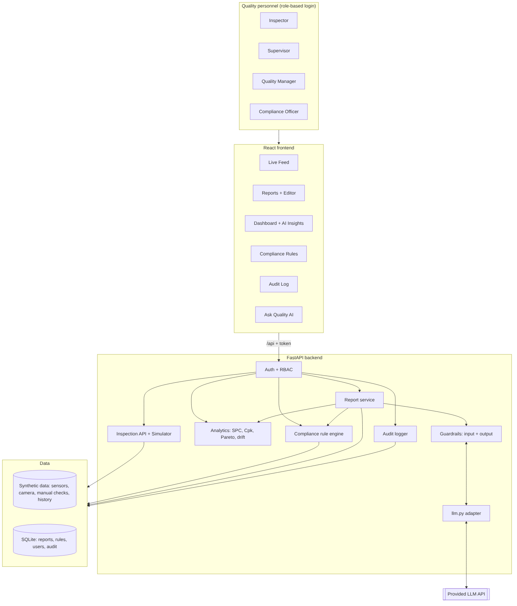
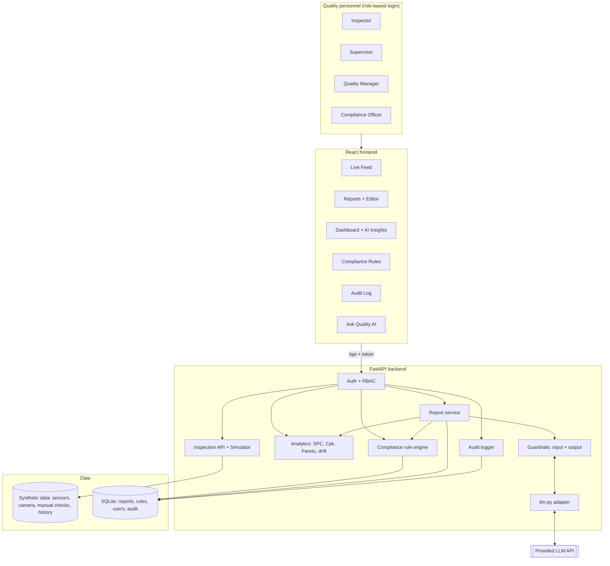
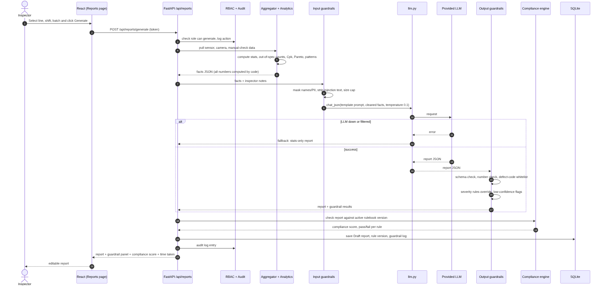
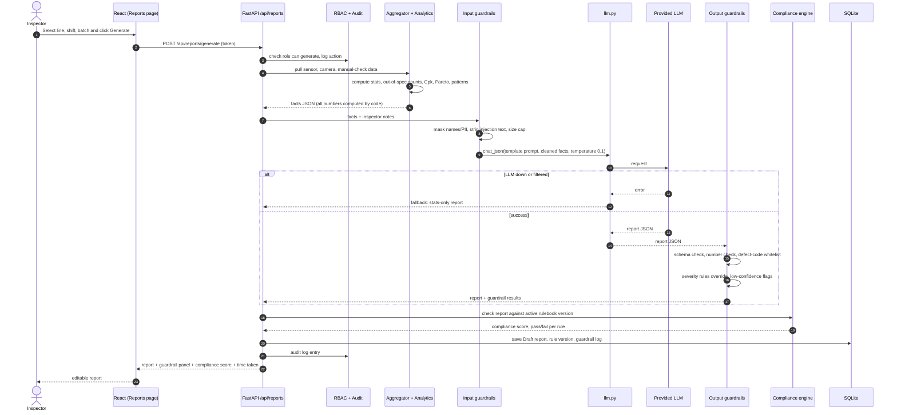
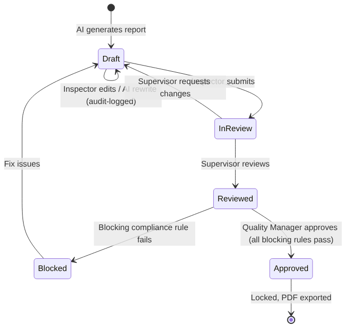
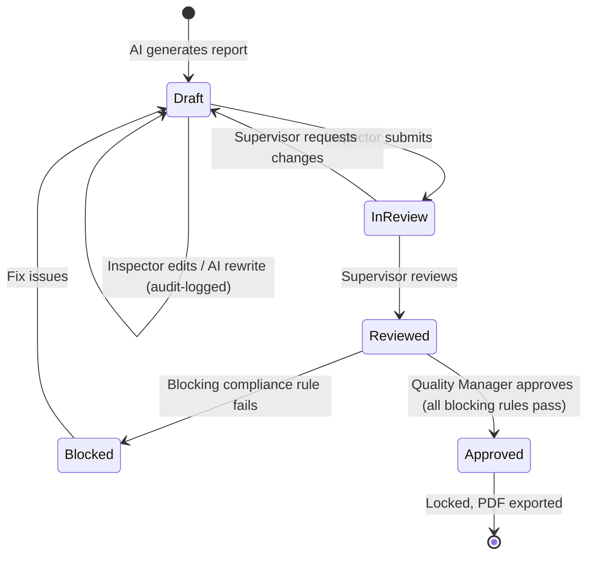
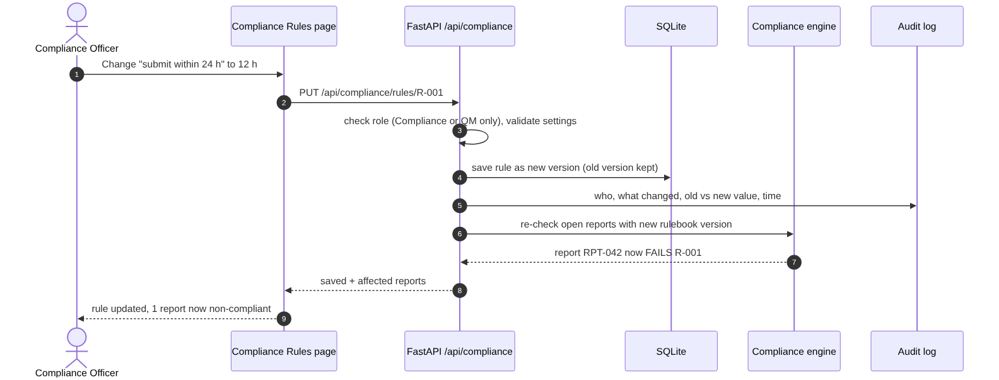
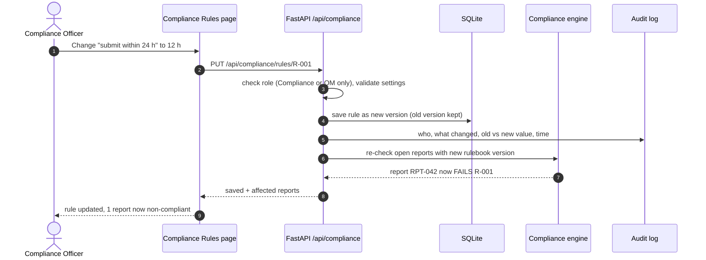
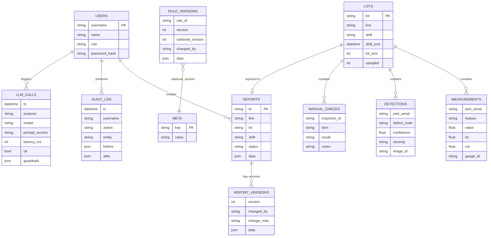
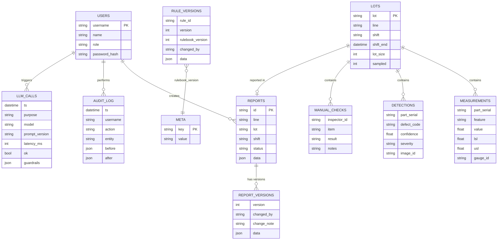

# InspectIQ — Mermaid diagrams

Mermaid.js source (renders on GitHub, mermaid.live, Notion). PNG versions are next to this file.

## 1. System architecture

## 2. Report generation flow (guardrails + compliance)

## 3. Report lifecycle and approval

## 4. Editing a compliance rule

## 5. Data model (SQLite tables + synthetic CSV data)

